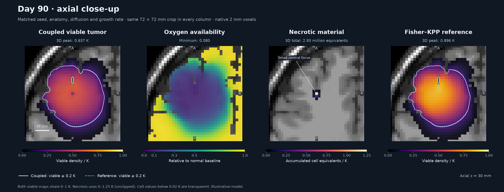

# BrainWeb tumor growth explorer

A standalone 3D tumor-growth demonstration with an interactive Jupyter notebook,
a conservative numerical solver, and PowerPoint/Google Slides media exports.
Choose the original Fisher–KPP model or coupled viable tumor, oxygen and
necrosis, with an optional matching Fisher–KPP reference.
Everything needed is inside this folder: source, BrainWeb data, a `uv` project
and lockfile, a local `.venv`, tests, and generated examples. The parent repository
and its Conda environment are not used.

## Brief history and clinical perspective

**Fisher–KPP** stands for Fisher–Kolmogorov–Petrovskii–Piskunov. In 1937,
[Fisher](https://doi.org/10.1111/j.1469-1809.1937.tb02153.x) and
[Kolmogorov–Petrovskii–Piskunov](https://math.i-learn.unito.it/mod/resource/view.php?forceview=1&id=73373)
developed reaction–diffusion descriptions of biological spread. Glioma models
later combined cell proliferation with invasion through brain tissue;
[Swanson et al. (2000)](https://doi.org/10.1046/j.1365-2184.2000.00177.x)
distinguished migration in gray and white matter. Extensions introduced
[oxygen, hypoxic phenotypes and necrosis](https://doi.org/10.1007/s11538-012-9786-1).

Recent work connects these models to measurements. A
[2025 study](https://doi.org/10.1186/s12885-025-14557-3) used serial MRI and
data assimilation to forecast treatment response in 21 patients. In 2026,
[MRI-derived cellularity, perfusion and hypoxia habitats](https://doi.org/10.1016/j.mri.2026.110744)
showed high test–retest repeatability in 24 glioma-bearing rats. A
[poromechanical-model preprint](https://arxiv.org/abs/2605.05013) reported
held-out tumor-volume errors of 4.7–36.0% in four rats; a
[September 2026 preprint](https://arxiv.org/abs/2609.22363) used simulated
biopsies to show that infiltration length can be estimated without tumor age,
whereas growth speed requires age information.

The clinical motivation is to estimate infiltration beyond visible MRI and
support individualized growth forecasts and treatment planning. Translation
requires identifiable parameters, uncertainty estimates and independent,
prospective validation. This repository provides a reproducible research
example: at day 90, oxygen–necrosis coupling reduced viable cell count by about
14.8% versus Fisher–KPP, while the volume above 20% of carrying capacity changed
by only about 1.9%. These BrainWeb-phantom results use assigned parameters and
are not patient predictions; see the manuscript for numerical limitations.

## Scientific manuscript

The [paper (PDF)](paper/output/pdf/brainweb_fisher_kpp_manuscript.pdf) and
[LaTeX/BibTeX sources](paper/README.md) report the 90-day coupled comparison,
controlled model ablations and numerical refinement, with appendices covering
the equations, schemes, BrainWeb data, parameter inference and validation.
Figures and tables are generated from recorded simulation arrays and metrics.
Biological parameters are assigned demonstration values; no patient fitting or
biological validation is claimed. Build with `make -C paper`, or rerun the
simulations and build with `make -C paper reproduce` after `uv sync --locked`.

## Start the notebook

In Terminal, change to this folder, then run:

```bash
uv sync --locked
uv run --locked jupyter lab tumor_growth_explorer.ipynb
```

Choose **Run All** in Jupyter. The application appears in the third cell. It uses
ipywidgets and the ipympl Matplotlib backend. Start Jupyter through this command
so the kernel uses this project's environment. VS Code can also use the local
`.venv/bin/python` kernel.

On macOS you can also double-click `launch_notebook.command` in Finder.

The existing environment is installed for this Mac. If you copy the folder to a
different location or computer, recreate `.venv` with `uv sync --locked`; virtual
environments themselves are not portable. A fresh install needs internet access
for Python packages (and Python 3.12 if absent). After installation, the notebook,
solver and animation generator run offline using the bundled data and ffmpeg.
`uv` itself must be installed separately if absent.

## Explore

- **Origin & density:** RAS x/y/z sliders or an MRI click place the seed. Choose
  three radii, a Gaussian or uniform ellipsoid, and peak density in cells/mm³.
  The center must be inside gray/white/glial tissue. Gaussian radii are σ and its
  support stops at 3σ; ellipsoid radii are semiaxes. Initial cells are restricted
  to gray/white/glial tissue.
- **Diffusion & growth:** set white/gray/CSF D in mm²/day, a smooth spatial
  multiplier, proliferation ρ in day⁻¹, and K in cells/mm³. The multiplier is
  centered at the seed and tends to one away from it. View the D map or tissue
  classes before running. A peak density independent of K makes K exploration
  meaningful; peak density must be ≤ K.
- **Model & oxygen:** Fisher–KPP remains the default. Select **Tumor + oxygen +
  necrosis** to enable all seven coupling parameters. The optional reference
  uses the same seed, grid, diffusion, proliferation and capacity. Coupled mode
  excludes CSF; the reference also disables CSF transport to match that domain.
- **Grid & time:** choose Δx, requested maximum Δt, duration, and saved-frame
  cadence. Automatic subdivision enforces diffusion stability. Disabling it
  rejects an unsafe Δt. Output times include t=0 and the exact final day.
- **Playback:** after running, use Play or the frame slider. With 3D storage
  enabled, the view sliders explore other slices. With it disabled, playback is
  through the seed's three planes. Editing model controls clears the old run.
- **Result view:** switch between viable tumor, oxygen, necrotic material and
  the reference, when available. Time and slice coordinates stay synchronized.
  The summary reports whole-volume metrics for the current day and both models.
- **Display → Side by side:** compare the coupled fields and optional reference
  in columns, with axial/coronal/sagittal slices in rows. One set of frame,
  playback and RAS slice controls updates every panel. **Planes** can show one
  orientation; all scales stay fixed at 0–1, with identical viable/reference
  colors. Collapse
  **Simulation parameters & export** to make more room for the comparison.
- **Export:** saves the current single-field or side-by-side display as MP4/GIF/poster,
  plus parameters, NIfTI fields, replay data, metrics and provenance. Four-field
  exports use the displayed slice coordinates and plane selection; single-field
  exports pass through the seed. Existing
  files in the selected output directory are replaced.

Open `coupled_example.ipynb` and **Run All** for a ready-to-use 90-day,
2 mm comparison with full 3D slice playback and the Fisher–KPP reference.

The default seed is at RAS (−30, 25, 30) mm in the left anterior brain. Parameters
are illustrative: D_WM=0.5, D_GM=0.1 mm²/day, D_CSF=0, ρ=0.04/day,
K=100,000 cells/mm³ and a 20,000 cells/mm³ Gaussian peak. The simulation lasts
180 days. The notebook saves every 3 days; the supplied presentation example
saves every 1.5 days for smoother playback. ρ is editable up to 0.3/day in the
GUI, including the 0.2/day used in the supplied slide example.

## Generate animations independently

The notebook does not need to be opened or executed:

```bash
uv run --locked python scripts/generate_animation.py \
  --config examples/presentation.json --dx 1 --output outputs/my_1mm_run
```

For a faster coarse run:

```bash
uv run --locked brainweb-kpp --dx 2 --days 90 --output outputs/quick
```

For a coupled demonstration with a dense initial seed and a matched reference:

```bash
uv run --locked brainweb-kpp --config examples/coupled.json --compare --dx 2 \
  --output outputs/coupled_demo --view viable
```

The example uses an 80,000 cells/mm³ Gaussian peak to demonstrate necrosis
early. In the GUI, choose coupled mode and set this peak for a similar run.
The default seed density remains 20,000 cells/mm³ for both models.

### Recorded 90-day comparison

Open [coupled_example.ipynb](coupled_example.ipynb) in the project's Jupyter
environment and choose **Run All** for the interactive four-field comparison.
The saved example is also available without running Python:

- [Side-by-side MP4](outputs/coupled_example/comparison.mp4) and
  [GIF](outputs/coupled_example/comparison.gif).
- [Slower 20-second MP4](outputs/coupled_example/comparison_slow_20s.mp4), with a
  six-second pause at day 90.
- [Day-90 axial close-up](outputs/coupled_example/day90_zoom_axial.png) and
  [all three anatomical planes](outputs/coupled_example/day90_zoom_all_planes.png).
- [Coupled metrics](outputs/coupled_example/growth_metrics.csv),
  [matched Fisher–KPP metrics](outputs/coupled_example/reference_fisher_kpp/growth_metrics.csv),
  [parameters](outputs/coupled_example/parameters.json), and
  [run provenance](outputs/coupled_example/run_metadata.json).
- [Paper experiment records](paper/data/experiments.json), including oxygen-only
  and fixed-supply ablations and time/grid refinement.



These are simulations on normal BrainWeb anatomy with assigned parameters.
The interactive/media necrosis color scale stops at `z/K = 1`; numerical values
can exceed one because this state counts cell equivalents rather than a tissue
volume fraction. The paper displays the full range and reports the sensitivity
of the small necrotic focus to grid spacing.

Render another field from the saved result without re-solving:

```bash
uv run --locked brainweb-kpp --replay outputs/coupled_demo \
  --output outputs/coupled_demo --view oxygen
uv run --locked brainweb-kpp --replay outputs/coupled_demo \
  --output outputs/coupled_demo --view necrosis
uv run --locked brainweb-kpp --replay outputs/coupled_demo \
  --output outputs/coupled_demo --view comparison --fps 5
```

`--model fisher_kpp|coupled` overrides the JSON model. `--compare` is valid for
coupled simulations; `--view reference` renders that matched reference. All
biological and oxygen-solver parameters can be set in the JSON config.

`--view comparison` exports viable tumor, oxygen, necrosis and the reference
in four synchronized columns, with all three anatomical planes in rows (4:3).
Use `--plane Axial|Coronal|Sagittal` for a single row (16:9). Every panel uses
the same saved time index and fixed 0–1 scale. Comparison exports require the
coupled model and reference. The MP4/GIF include initial and final holds.

Re-render an existing simulation without solving again:

```bash
uv run --locked brainweb-kpp --replay outputs/example_1mm \
  --output outputs/reformatted --width 1280 --fps 10
```

Use `--formats mp4` or `--formats gif` to generate only one format, or
`--simulate-only` to save the numerical result without media. `--width` must be
at least 640 and divisible by 32. A copied JSON file can set any field in
`Parameters` (see `examples/presentation.json`). CLI Δx defaults to 1 mm; the
notebook defaults to 2 mm. Both call the same 3D solver. Rendering saved planes
does not require holding 3D history in memory.

### Supplied artifacts

`outputs/example_1mm/` contains:

| File | Purpose |
| --- | --- |
| `tumor_growth.mp4` | 1920 × 1080, H.264, yuv420p, silent, 12 fps, faststart |
| `tumor_growth.gif` | 960 × 540, shared palette, continuous loop |
| `poster.png` | Final frame for a slide thumbnail |
| `parameters.json` | Exact physical and numerical inputs |
| `run_metadata.json` | Grid, actual step, runtime, versions and data provenance |
| `media_metadata.json` | Dimensions, cadence and playback duration |
| `simulation.npz` | Plane histories, T1 backgrounds, times and metrics for replay |
| `final_density_cells_mm3.nii.gz` | Final 3D density with its physical affine |
| `growth_metrics.csv` | Total cells and 20%/80% K threshold volumes |

Coupled exports additionally contain `final_oxygen_relative.nii.gz`,
`final_necrosis_cells_mm3.nii.gz`, all three fields' plane histories, and the
parenchymal mask. Oxygen outside that mask is zero as an excluded-domain
sentinel, not an oxygen estimate. The viewer hides those voxels. Reference
results are saved in `reference_fisher_kpp/`. Original replays remain readable.
The viable movie/poster filenames are retained; other views use `oxygen.mp4`,
`necrosis.mp4`, `reference.mp4` and corresponding GIF/poster/metadata filenames,
so exporting another view does not replace the viable movie. Replay saves seed
planes and final fields; arbitrary 3D history is kept only in the live explorer.
Four-field exports use `comparison.mp4`, `comparison.gif`, `comparison_poster.png`
and `comparison_media_metadata.json`. Their metadata records the shared saved
times, rendered frame order, fields, slices and anatomical planes.

The MP4 is intended for insertion as video in PowerPoint. For Google Slides,
upload the MP4 to Google Drive and insert it as a Drive video. The looping GIF
can be inserted as an image in either application. Use slideshow/presentation
mode to check playback; the editor or static preview may only show one frame.
These files are media assets; no existing presentation is modified.

## Numerical model

The model is

```text
∂n/∂t = ∇·(D(x) ∇n) + ρ(x) n (1 − n/K(x))
(D ∇n)·ν = 0
```

It models simultaneous invasion and proliferation. It does not explicitly
implement a go-or-grow phenotype switch. There is no treatment, tissue
deformation/mass effect or DTI fiber anisotropy. The original model has no necrosis. D is an isotropic
scalar field within each tissue, optionally modulated smoothly in space.

Cell-centered fluxes use a symmetric harmonic mean of D at neighboring voxels.
This implements the divergence-form operator at heterogeneous tissue interfaces,
conserves cells under pure diffusion, and sets flux to zero at impermeable
interfaces. Domain-edge faces are closed. No periodic wrapping is used.

Each step uses explicit diffusion followed by the exact logistic reaction:

```text
a_ij = harmonic_mean(D_i, D_j) / h²
n*_i = n_i + Δt Σ_j a_ij (n_j − n_i)
n_new_i = n*_i / [exp(−ρ_i Δt) + (n*_i/K_i)(1 − exp(−ρ_i Δt))]
```

The safe positivity bound is `Δt <= 0.9 / max_i Σ_j a_ij`, reducing to
`0.9 h²/(6 D)` for constant diffusion in 3D. The method is first order in time;
the centered diffusion stencil is second order in smooth regions, but sharp
tissue interfaces and label resampling limit spatial accuracy. No density
clipping conceals instability. Output frames and solver steps are independent.

Diffusion and logistic flow preserve nonnegative density. Uniform K is an upper
bound when the initial field is ≤ K. Spatially varying K can be exceeded locally
by incoming diffusion; such results are not clipped.

The Python `simulate` API accepts optional `diffusion`, `proliferation` and
`capacity` coefficient arrays on the current grid. The GUI exposes tissue and
spatial diffusion with uniform tissue proliferation and uniform carrying
capacity. Extracerebral transport is always disabled, CSF reaction is zero,
and glial class 8 uses gray matter defaults. Custom maps are marked in metadata;
save those input arrays yourself for custom-map reproducibility. The standard
slide renderer's n/K scale uses the scalar K in `Parameters`, so use separate
visualization for a custom spatial K.

The media show axial, coronal and sagittal planes through the seed, a common
fixed inferno n/K scale, and whole-volume metrics. Overlay values below 0.02 K
are hidden. Volumes at 0.2 K and 0.8 K are illustrative thresholds and are not
calibrated MRI detection boundaries. The faint complete curves provide context;
the vertical cursor marks the current time.

## Coupled tumor / oxygen / necrosis model

The viable field `c` uses the existing density units (cells/mm³); `z` stores
immobile necrotic tumor material in cell equivalents/mm³. Relative oxygen `o`
has a normal-tissue baseline of one. The reduced model is

```text
φ = (c + z) / K                 [a]₊ = max(a, 0)
g(o) = min(1, o / θp)           h(o) = [1 − o / θd]₊
p = 1 / (1 + α φ)

∂c/∂t = ∇·(D ∇c) + ρ g(o) c [1 − φ]₊ − δ h(o) c
∂z/∂t = δ h(o) c − λz z
0     = ℓo² ∇²o + p (1 − o) − β (c/K) o
```

Both diffusion operators have closed/no-flux boundaries on GM/WM/glial tissue.
Oxygen is solved at initialization and after every tumor step. It is consumed
by viable tumor and restored by a distributed exchange term. Baseline normal
metabolism is implicit in the normal-tissue reference; there is no explicit
healthy-cell population. Necrotic material consumes no oxygen and limits births.
The perfusion closure is a phenomenological modeling assumption; setting α = 0
holds oxygen delivery fixed. This version has no dynamic vascular state,
phenotype switching, directed hypoxic migration, or mass effect.

| Parameter | Meaning | Units | Default |
| --- | --- | --- | --- |
| `oxygen_length_mm` (ℓo) | Effective diffusion/exchange length | mm | 0.2 |
| `oxygen_uptake_ratio` (β) | Tumor uptake / baseline restoration | dimensionless | 4 |
| `perfusion_suppression` (α) | Delivery reduction with total burden | dimensionless | 4 |
| `oxygen_prolif_level` (θp) | Oxygen for unrestricted proliferation | relative oxygen | 0.3 |
| `oxygen_death_level` (θd) | Threshold for hypoxic death | relative oxygen | 0.1 |
| `necrosis_rate` (δ) | Maximum transfer rate to necrosis | day⁻¹ | 0.5 |
| `necrosis_clearance` (λz) | Necrotic removal rate | day⁻¹ | 0 |

Require `0 < θd < θp < 1`. All new defaults are illustrative, not calibrated
patient parameters. Necrotic equivalents do not measure all injured host tissue.
At millimeter grids, oxygen is a voxel-averaged availability proxy; the default
0.2 mm exchange length and individual capillary gradients are not resolved.
`K` regulates births rather than enforcing hard packing: incoming diffusion may
exceed `c+z=K`. Densities are not clipped.

The oxygen system is `[-ℓo² L + diag(p + β c/K)] o = p`. A compact matrix-free
stencil with Jacobi-preconditioned conjugate gradients avoids a full-grid sparse
matrix. `oxygen_rtol=1e-7` and `oxygen_maxiter=200` can be changed in JSON/Python;
failed convergence raises an error. Solver iterations and maximum relative
residual are recorded. Tiny oxygen bound deviations at solver tolerance are
not hidden by clipping.

Tumor steps retain the existing conservative explicit diffusion bound. With
oxygen and necrosis frozen, births use exact logistic flow with
`K_eff=K-z`, `rho_eff=ρ g(o)(1-z/K)` whenever `z<K` and `c<K-z`; otherwise births
are zero. Exact exponential death transfers the same amount from `c` into `z`.
Clearance is exponential. This Lie splitting is first order; the diffusion
positivity limit does not establish reaction/coupling accuracy. Refine Δt for
quantitative comparisons.

With zero oxygen uptake and no initial necrosis, oxygen is one and the coupled
model recovers standard constant-K Fisher–KPP for initial density ≤ K. In Python:

```python
from brainweb_kpp import Parameters, load_brainweb, simulate
p = Parameters(model="coupled")
result = simulate(load_brainweb(2), p, compare=True)
# Existing final_density / planes / volumes remain the viable field.
# Also: final_oxygen, final_necrosis, oxygen_planes, necrosis_planes,
# oxygen_volumes, necrosis_volumes, tissue_mask, comparison.
```

Coupled metrics add necrotic cell equivalents, necrotic volume above 0.2 K,
parenchymal volume below θd, and minimum parenchymal oxygen. View scales are
fixed 0–1: inferno for viable density, viridis for oxygen, magma for necrosis.
Only density overlays hide values below 0.02 K. No threshold is an MRI boundary.

Biological motivation: Martínez-González et al. (2012), *Hypoxic Cell Waves Around
Necrotic Cores in Glioblastoma*, [DOI](https://doi.org/10.1007/s11538-012-9786-1).
The three-field closure here is a proposed reduction, not that paper's full model.

## Data and provenance

The bundled T1 is `T1 ICBM normal 1mm pn0 rf0`, copied without modification from
the repository's existing BrainWeb NIfTI. The matching **original normal**
discrete phantom was downloaded from BrainWeb and converted from MINC to NIfTI
with nibabel. T1 and labels are canonical RAS+, 181 × 217 × 181, 1 mm isotropic,
starting at (−90, −126, −72) mm. Affines match exactly. These are simulated
normal-anatomy images; no real tumor is present in the source data.

The label map supplies tissue ground truth: CSF=1, GM=2, WM=3, glial matter=8.
This avoids assigning tissue from T1 intensity thresholds. Other classes remain
outside the growth domain. T1 is resampled linearly, labels by nearest neighbor.
The coarse-grid upper edge may shift by less than one requested spatial step.

`data/manifest.json` records the source aliases and SHA-256 checksums. Notebook
startup and CLI verify those checksums. To restore missing NIfTI data:

```bash
uv run --locked python scripts/fetch_data.py
```

The script uses the official BrainWeb download form and converts MINC directly;
FreeSurfer is unnecessary. It leaves optional personal information blank. MINC
to NIfTI conversions may produce a different file encoding/checksum; review the
manifest when regenerating data. BrainWeb data retain their original terms and
attribution rather than inheriting the parent repository's software license.

Sources to acknowledge in presentations/publications:

- [BrainWeb simulated brain database](https://brainweb.bic.mni.mcgill.ca/brainweb/)
  and [normal anatomical model](https://brainweb.bic.mni.mcgill.ca/anatomic_normal.html).
- Collins DL et al. (1998). *Design and construction of a realistic digital brain
  phantom*. IEEE TMI 17(3), 463–468. [DOI](https://doi.org/10.1109/42.712135).
- Cocosco CA et al. (1997). *BrainWeb: Online Interface to a 3D MRI Simulated Brain
  Database*. NeuroImage 5(4), S425.
- Everett R et al. (2020). *A tutorial review of mathematical techniques for
  quantifying tumor heterogeneity*. MBE 17(4), 3660–3709.
  [DOI](https://doi.org/10.3934/mbe.2020207), referenced in the supplied slides.

## Performance on Apple Silicon

The solver uses float32 arrays and compiled Numba CPU kernels, up to eight
threads, without CUDA or GPU dependencies. It runs natively on an M4 Max.
The command-line generator stores only planes plus the final volume. Notebook
3D history costs about 28 MB per 1 mm frame (about 1.7 GB for 61 frames); 2 mm
history is roughly eight times smaller. Coupled history stores three fields;
a matched reference adds a fourth, for about 6.8 GB at 61 native-resolution frames. The 128 GB machine has ample memory for
these defaults. At 0.5 mm, both memory and the number of stable steps rise
substantially. An 8 GB history guard asks for coarser output if necessary.

Choose 2 mm while exploring, then rerun at 1 mm. For quantitative use, compare
smaller time steps and successively finer grids with the same physical seed
and coefficients. Anatomical resolution remains 1 mm even if Δx=0.5 mm.
Measured example runtime is recorded in `outputs/example_1mm/run_metadata.json`;
the first simulation also pays a Numba compilation cost. Rendering is separate.

## Verify

```bash
uv run --locked pytest -q
```

Tests also check uniform and nonuniform analytical oxygen solutions, no-flux
oxygen barriers, exact death transfer and clearance, occupied capacity, recovery
of Fisher–KPP, live-plus-dead conservation, coupled time refinement against an
independent RK4 solution, solver failure reporting, all field renders, and old/new
replay compatibility. Notebook checks exercise both models, all field views,
matched references, arbitrary slices, and plane-only playback.

Tests check exact logistic growth without diffusion, heterogeneous-diffusion
mass conservation and positivity, impermeable CSF/extracerebral boundaries,
absence of periodic wrapping, unstable-step rejection, the uniform capacity
bound, a reflecting-boundary cosine eigenmode, temporal refinement, exact output
times, parameter validation, and bundled BrainWeb alignment/tissue counts.

The notebook is also executed as a smoke test; the actual GUI can be opened in
JupyterLab for clicks and playback. The generated MP4 and GIF are decoded and
visually inspected. These checks validate implementation behavior; they do not
establish patient-level biological validity.

To repeat the notebook and short widget simulation check:

```bash
uv run --locked python scripts/check_notebook.py
```
