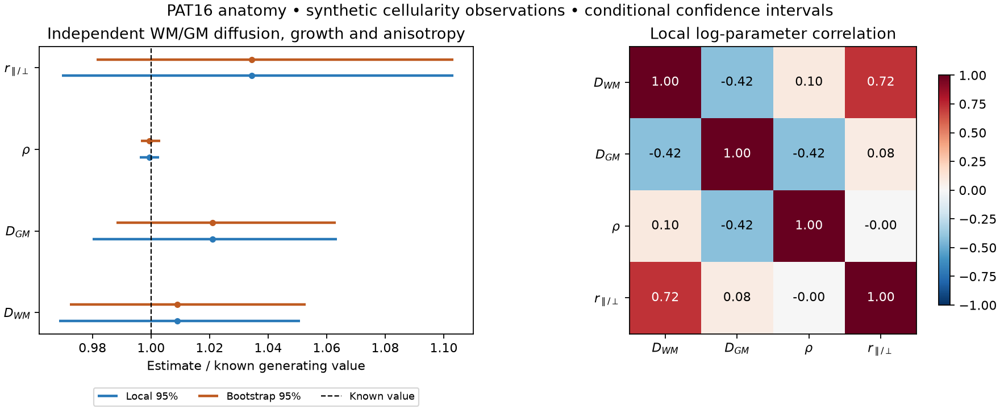
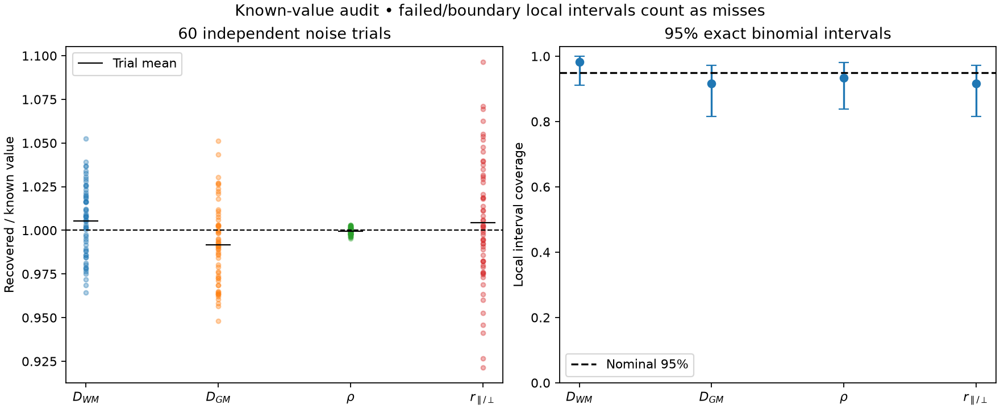
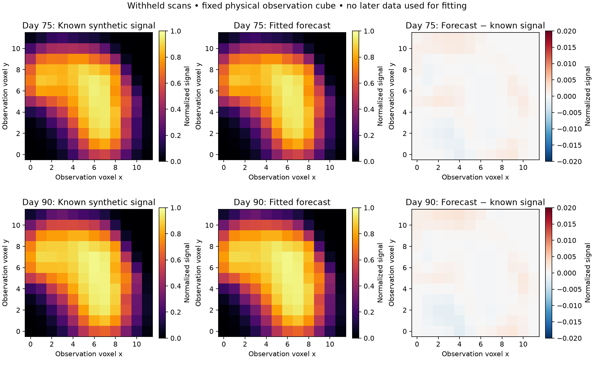

# PAT16 synthetic parameter recovery — recorded results

Four parameters fitted to synthetic longitudinal cellularity proxies on real PAT16
pre-operative anatomy and dMRI directions. These are **conditional synthetic recovery
results**, not rates estimated from patient tumor measurements.

[Notebook](../../pat16_synthetic_parameter_recovery.ipynb) · [Design and rerun instructions](../../examples/pat16_recovery.md)

| Parameter | Known | Estimate | Local 95% CI | Bootstrap 95% CI | Local coverage |
|---|---:|---:|---|---|---:|
| D_WM (mm²/day) | 0.500000 | 0.504441 | [0.484292, 0.525427] | [0.486119, 0.526465] | 59/60 |
| D_GM (mm²/day) | 0.100000 | 0.102091 | [0.097999, 0.106354] | [0.098818, 0.106307] | 55/60 |
| ρ (day⁻¹) | 0.040000 | 0.039976 | [0.039844, 0.040108] | [0.039861, 0.040126] | 56/60 |
| WM anisotropy ratio | 2.500000 | 2.585762 | [2.424139, 2.758161] | [2.453541, 2.758188] | 55/60 |

All four generating values fall inside both interval types in this fixed primary
realization. The full run used 100 bootstrap fits and 60 independent noise trials,
with no failed or boundary fits. The local coverage counts above have broad exact
binomial intervals, reported in `summary.json`; they do not establish bootstrap
coverage. The mean relative biases across noise trials were +0.534%, -0.819%, -0.042%, +0.434%, respectively.

## Original withheld-scan records

Scans at days 20/40/60 were fitted; days 75/90 were withheld from fitting and
uncertainty estimation. Over the full 1,728-voxel observation cube:

| Day | RMSE against known signal | Noisy RMSE / noise SD | Truth in signal interval | Observation in prediction interval |
|---:|---:|---:|---:|---:|
| 75 | 0.000584 | 0.9989 | 97.86% | 93.17% |
| 90 | 0.000662 | 1.0006 | 98.84% | 93.11% |

Signal intervals propagate parameter uncertainty; prediction intervals add new
observation noise. The finite 100-draw prediction intervals contain about 93% of
held-out observations in this realization. These legacy intervals remain unchanged
here for provenance. The improved intervals and nested coverage audit are saved
separately in [../pat16_prediction/](../pat16_prediction/README.md). The manuscript
and replay notebook use the improved Gaussian-mixture intervals, which contain
94.85%/95.49% of the two primary images with widths 0.05886/0.05889. Spatial fractions are descriptive,
not independent coverage trials. Near-center metrics and interval widths are
recorded in the summary.

## Numerical and identifiability checks

The noise-free matched-model fit recovered all parameters with maximum relative error 4.66e-15.
The generator used a 0.25-day step and inversion used 0.5 day. Fitting the finer-time
noise-free signals shifted WM diffusion, GM diffusion, proliferation and anisotropy
by -0.087%, -0.309%, -0.092%, -0.100%, respectively. Time-zero-only inference was rejected as
unidentifiable. Tests additionally reject absent directional information and a
single tissue class. These checks share the spatial anatomy and numerical stencil;
they do not establish spatial convergence or biological validity.

## Files and reproducibility

- `summary.json`: settings, estimates, intervals, bias/RMSE, exact binomial coverage
  intervals, forecasts, numerical checks and all fit failures.
- `parameters.csv`: compact parameter table.
- `recovery_data.npz`: complete observations, bootstrap draws/predictions, independent
  noise fits/intervals, forecast bands, correlation matrix and region mask.
- `provenance.json`: external input, code and output hashes; software versions and
  coordinate metadata. Raw MRI is read in place and is not redistributed.

The fixed seed is 161026. The recorded computation took 7.7 minutes on this machine.
The notebook can replay these checked records without access to external MRI.
Run `uv run --locked python scripts/run_pat16_recovery.py` from the project root
with the required PAT16 derivatives to reproduce the full audit.

Intervals condition on fixed tissue geometry, normalized initialization, directions
and signal/noise calibration. Uniform capacity cancels from normalized dynamics;
absolute capacity and cell counts are not identified. They omit segmentation, registration, direction,
initial-state, spatial-discretization and model uncertainty. No patient growth-rate
fit, untreated longitudinal patient validation or functional prediction is claimed.
